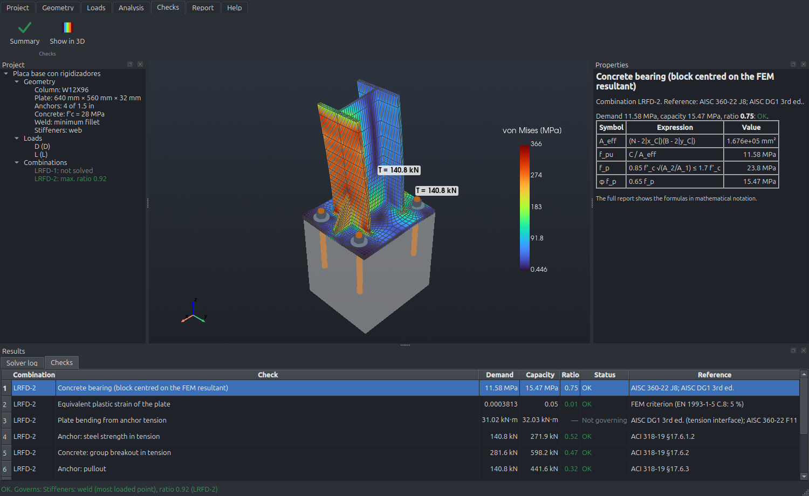

# OpenFEMConex

**English** · [Español](README.md)

Open-source desktop application for steel connection design with finite
elements. It currently handles **column base plates with anchor rods**: it builds
the model, solves it with [CalculiX](http://www.calculix.de/) and checks every
component per **AISC 360**, **AISC Design Guide 1** and **ACI 318 Chapter 17**,
with the forces from the model.

Free software under [AGPL-3.0-or-later](LICENSE).



## What it does

- **Component-based FEM model.** Column, plate and stiffeners as elastic-plastic
  steel solids; concrete with tension-free contact and friction; anchors as
  tension-only springs tied to the washer; shear lug as a bearing spring.
- **Geometry.** AISC W, M, S, HP, rectangular, square and round HSS and Pipe;
  anchors in rows or at coordinates; welded plate washers; stiffeners (W shapes
  and tubes); shear lug; pedestal with reinforcement, 90° or 180° hooks and U
  hairpins.
- **Loads.** P, V and M about both axes; ASCE 7 LRFD and ASD or custom
  combinations; net uplift.
- **Checks**, each with its formula, values and clause:

  | Component | Checks |
  |---|---|
  | Concrete | Bearing (AISC 360 J8), breakout in tension and shear, pryout, side-face blowout (ACI 318 §17.6 and §17.7) |
  | Anchors | Steel in tension and shear, pullout, interaction (§17.8), tension with shear and bending with welded washer (AISC J3) |
  | Plate | FEM plastic strain and bending from anchor tension (DG1) |
  | Welds | Column-to-plate and stiffeners with directional increase (AISC J2.4) |
  | Pedestal | Anchor reinforcement (§17.5.2.1), axial force with bending, minimum steel |
  | Shear | Friction or shear lug (§17.11) |

- **Editions.** Current codes (AISC 360-22, ACI 318-19) or those of DG1 2nd ed.
  (AISC 360-05, ACI 318-08) to reproduce its examples.
- **Report** in HTML or PDF with figures of geometry, stresses, plastic strain,
  displacements, contact pressure and forces per anchor.
- **Interface** with a ribbon by stage, 3D view, built-in help, Spanish and
  English, light and dark themes. It also runs from the command line.

## Validation

The examples of Design Guide 1 are reproduced by the automatic tests. Some FEM
results:

| Example | Guide | OpenFEMConex |
|---|---|---|
| DG1 2nd ed. 4.7, large moment: anchor tension | 76.0 kips | 76.7 kips |
| DG1 2nd ed. 4.5, uplift: force per anchor | 17.5 kips | 17.5 kips |
| DG1 2nd ed. 4.11, anchor with welded washer | 46.7 > 25.1 ksi | 46.7 > 25.1 ksi |

Details (in Spanish) in [docs/validacion.md](docs/validacion.md) and
[docs/verificaciones.md](docs/verificaciones.md).

## Installation

Requires Python 3.12 and CalculiX (`ccx`).

```bash
sudo apt install calculix-ccx
```
```bash
python3 -m venv .venv && .venv/bin/pip install -e ".[gui]"
```

[OpenConex](https://github.com/marcel1983/openconex), which supplies the AISC
shape catalog, the materials and the project format, and Gmsh are installed as
dependencies. To use another CalculiX executable set `OPENFEMCONEX_CCX`.

On Linux, Qt needs `libxcb-cursor0`.

## Usage

```bash
.venv/bin/openfemconex-gui examples/dg1_2ed_ej_4_7.ocnx
```
```bash
.venv/bin/openfemconex run examples/dg1_2ed_ej_4_7.ocnx --combo LRFD-2
```

Projects are OpenConex `.ocnx` files; the `examples` folder has the guide
examples and cases with stiffeners, a reinforced pedestal and a shear lug. The
in-app help (Help tab) explains the workflow, the model and the checks; switch
the interface to English in Project › Appearance.

## Packaging

`packaging/openfemconex.spec` builds a PyInstaller application that bundles Gmsh
and, when present on the system, CalculiX.

## Development

```bash
.venv/bin/pip install -e ".[gui,dev]" && .venv/bin/python -m pytest
```

Tests marked `ccx` run CalculiX and take a few minutes; skip them with
`-m "not ccx"`.

## Notice

A support tool. The design is the responsibility of the engineer who signs it,
who must verify the results.

## License

[AGPL-3.0-or-later](LICENSE). Uses CalculiX (GPL), Gmsh (GPL), OpenConex (GPL),
Qt for Python (LGPL), VTK and PyVista (BSD/MIT); GPL-3.0 works can be combined
with AGPL-3.0 (section 13). If you offer a modified version as a network service,
you must give its users the source code. The reports and models you create with
OpenFEMConex are yours.
