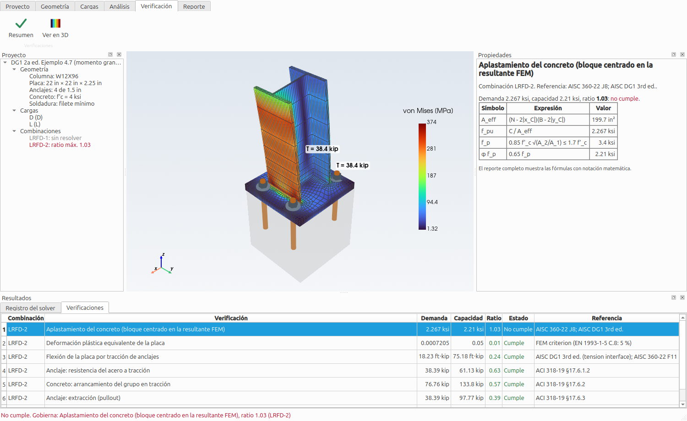

# OpenFEMConex

[English](README.en.md) · **Español**

Aplicación de escritorio de código abierto para diseñar conexiones de acero con
elementos finitos. Hoy resuelve **placas base de columna con anclajes**: arma el
modelo, lo resuelve con [CalculiX](http://www.calculix.de/) y verifica cada
componente según **AISC 360**, la **Guía de Diseño 1 del AISC** y el **ACI 318,
capítulo 17**, con las fuerzas que da el modelo.

Software libre bajo [AGPL-3.0-or-later](LICENSE).



## Qué hace

- **Modelo FEM por componentes.** Columna, placa y rigidizadores como sólidos de
  acero elástico-plástico; concreto con contacto sin tracción y fricción; anclajes
  como resortes solo a tracción unidos a la arandela; llave de cortante como
  resorte de aplastamiento.
- **Geometría.** Perfiles W, M, S, HP, HSS rectangular, cuadrado y circular y Pipe
  del catálogo AISC; anclajes en filas o por coordenadas; arandelas soldadas;
  rigidizadores (perfiles W y tubos); llave de cortante; pedestal con refuerzo,
  ganchos de 90° o 180° y horquillas en U.
- **Columnas y materiales.** Columnas cruciformes (perfil W y perfil cruzado en
  dos T); perfiles I armados de placas con editor y propiedades; editor de aceros
  y grados de anclaje con ley constitutiva bilineal, elastoplástica, trilineal o
  por tabla y vista previa de la curva.
- **Análisis.** Malla automática normal o rápida (entre un quinto y la mitad del
  tiempo); ventana de avance con cada incremento de CalculiX y botón Cancelar.
- **Cargas.** P, V y M en los dos ejes; combinaciones ASCE 7 LRFD y ASD o propias;
  levantamiento neto.
- **Verificaciones**, cada una con su fórmula, valores y cláusula:

  | Componente | Verificaciones |
  |---|---|
  | Concreto | Aplastamiento (AISC 360 J8), arrancamiento en tracción y cortante, palanca, desprendimiento lateral (ACI 318 §17.6 y §17.7) |
  | Anclajes | Acero a tracción y cortante, extracción, interacción (§17.8), tracción con cortante y flexión con arandela soldada (AISC J3) |
  | Placa | Deformación plástica del FEM y flexión por tracción de anclajes (DG1) |
  | Soldaduras | Columna-placa y rigidizadores con aumento direccional (AISC J2.4) |
  | Pedestal | Refuerzo de anclaje (§17.5.2.1), flexocompresión y cuantía mínima |
  | Cortante | Fricción o llave de cortante (§17.11) |

- **Ediciones.** Normas vigentes (AISC 360-22, ACI 318-19) o las de la DG1 2.ª ed.
  (AISC 360-05, ACI 318-08) para reproducir sus ejemplos.
- **Reporte** en HTML o PDF con gráficos de geometría, esfuerzos, deformación
  plástica, desplazamientos, presión de contacto y fuerzas por anclaje.
- **Interfaz** con ribbon por etapas, visor 3D, ayuda integrada, español e inglés
  y tema claro u oscuro. También se usa desde la línea de comandos.

## Validación

Los ejemplos de la Guía de Diseño 1 se reproducen en las pruebas automáticas.
Algunos resultados del FEM:

| Ejemplo | Guía | OpenFEMConex |
|---|---|---|
| DG1 2.ª ed. 4.7, momento grande: tracción en anclajes | 76.0 kips | 76.7 kips |
| DG1 2.ª ed. 4.5, levantamiento: fuerza por anclaje | 17.5 kips | 17.5 kips |
| DG1 2.ª ed. 4.11, anclaje con arandela soldada | 46.7 > 25.1 ksi | 46.7 > 25.1 ksi |

Detalle en [docs/validacion.md](docs/validacion.md) y
[docs/verificaciones.md](docs/verificaciones.md).

## Instalación

Requiere Python 3.12 y CalculiX (`ccx`).

```bash
sudo apt install calculix-ccx
```
```bash
python3 -m venv .venv && .venv/bin/pip install -e ".[gui]"
```

[OpenConex](https://github.com/marcel1983/openconex), que aporta el catálogo de
perfiles AISC, los materiales y el formato de proyecto, y Gmsh se instalan como
dependencias. Para usar otro ejecutable de CalculiX defina `OPENFEMCONEX_CCX`.

En Linux, Qt necesita `libxcb-cursor0`.

## Uso

```bash
.venv/bin/openfemconex-gui examples/dg1_2ed_ej_4_7.ocnx
```
```bash
.venv/bin/openfemconex run examples/dg1_2ed_ej_4_7.ocnx --combo LRFD-2
```

Los proyectos son archivos `.ocnx` de OpenConex; la carpeta `examples` tiene los
ejemplos de la guía y casos con rigidizadores, pedestal reforzado y llave de
cortante. La ayuda del programa (pestaña Ayuda) explica el flujo de trabajo, el
modelo y las verificaciones. Ver también [docs/interfaz.md](docs/interfaz.md).

## Empaquetado

`packaging/openfemconex.spec` arma con PyInstaller una aplicación que incluye
Gmsh y, si está en el sistema, CalculiX.

## Desarrollo

```bash
.venv/bin/pip install -e ".[gui,dev]" && .venv/bin/python -m pytest
```

Las pruebas marcadas `ccx` corren CalculiX y tardan unos minutos; se omiten con
`-m "not ccx"`.

## Aviso

Herramienta de apoyo. La responsabilidad del diseño corresponde al profesional
que lo firma, que debe verificar los resultados.

## Licencia

[AGPL-3.0-or-later](LICENSE). Usa CalculiX (GPL), Gmsh (GPL), OpenConex (GPL),
Qt for Python (LGPL), VTK y PyVista (BSD/MIT); las licencias GPL-3.0 son
compatibles con la AGPL-3.0 (sección 13). Si ofrece el programa modificado como
servicio en red, debe dar acceso a su código fuente. Las memorias y modelos que
genere con OpenFEMConex son suyos.
