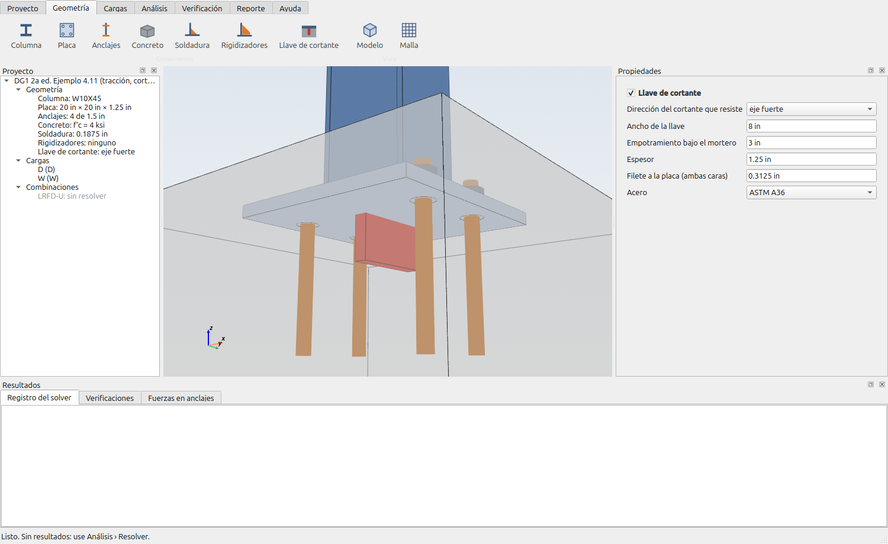
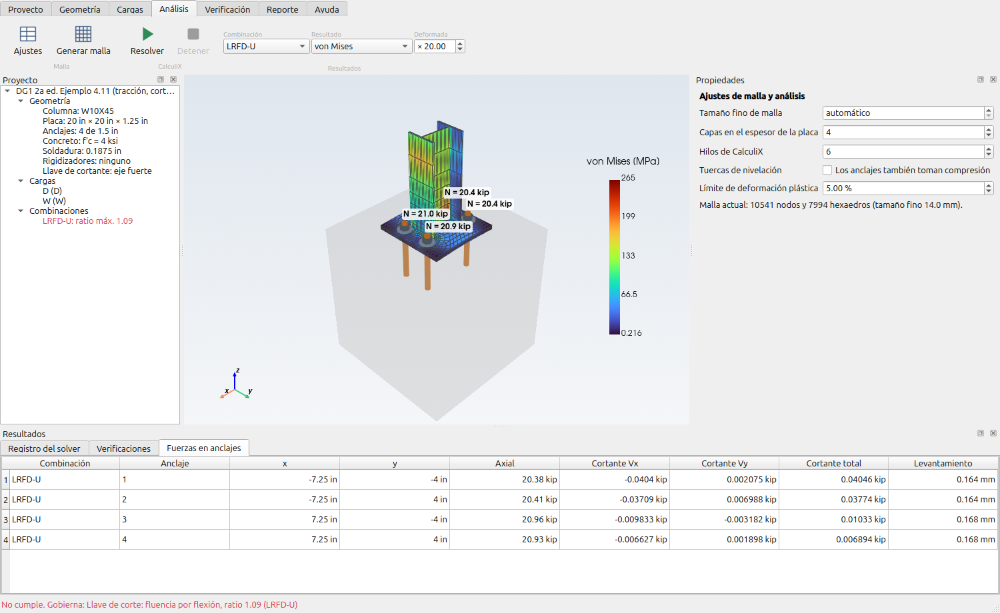
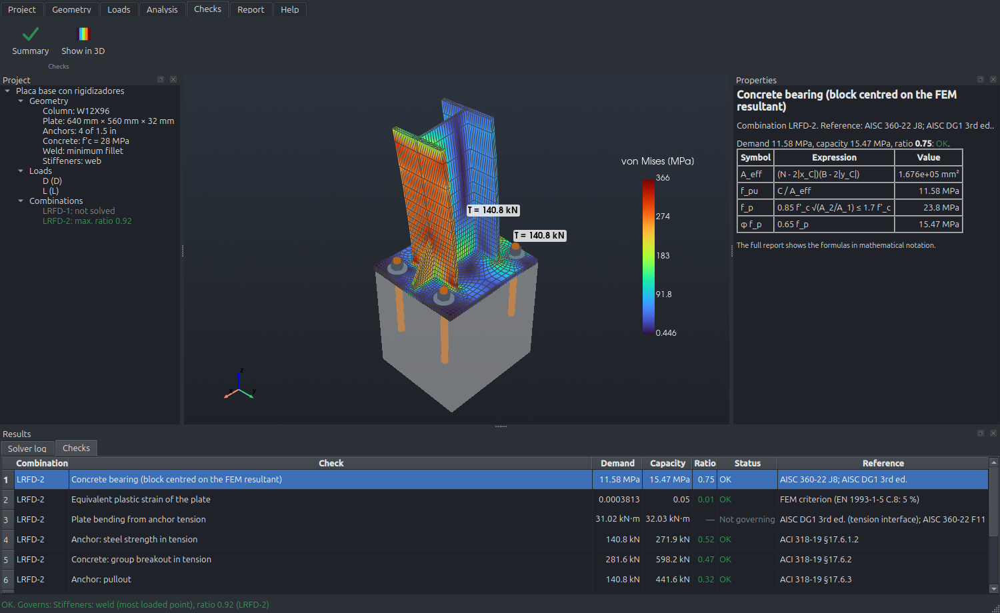
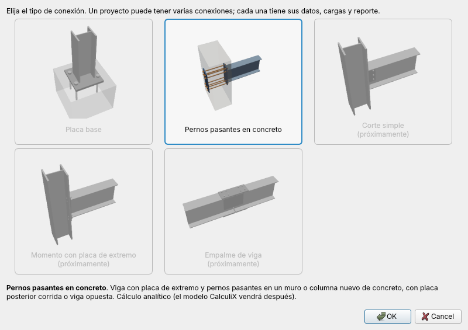
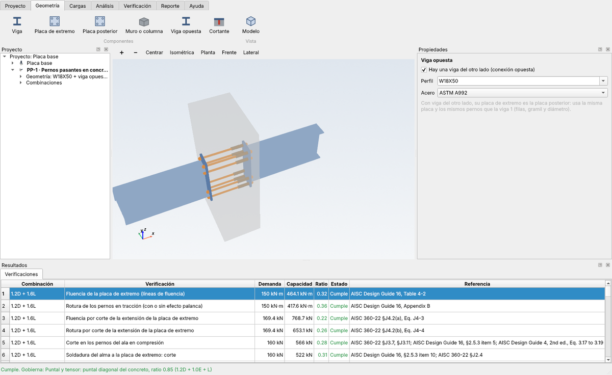
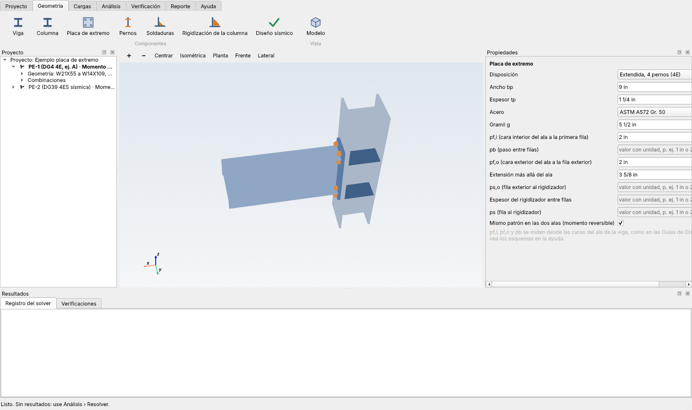

# Interfaz gráfica

```bash
./run-gui.sh examples/dg1_2ed_ej_4_7.ocnx
```

`run-gui.sh` lanza la interfaz desde este directorio. Qt necesita la librería
`libxcb-cursor0`; si no está instalada (`sudo apt install libxcb-cursor0`) el
script usa la copia local de OpenConex cuando existe.


## Flujo por etapas

El ribbon tiene una pestaña por etapa, en el orden de trabajo.

| Pestaña | Qué se hace |
|---|---|
| Proyecto | Nuevo, abrir y guardar (`.ocnx`, el mismo formato de OpenConex); unidades de presentación; normas (vigentes o las de la DG1 2.ª ed.) |
| Geometría | Columna (catálogo AISC con búsqueda), placa, anclajes, concreto y soldadura. El modelo 3D se actualiza al confirmar cada dato. Vista de modelo o de malla |
| Cargas | Tabla de casos (P, V, M en los dos ejes) y combinaciones ASCE 7 generadas, LRFD y ASD. Se marcan las que se van a resolver |
| Análisis | Ajustes de malla e hilos, botón verde **Resolver** (analítico + FEM, también en el panel de ajustes), resolver con CalculiX en segundo plano (con avance y botón de detener) y resultados en 3D: von Mises, deformación plástica, presión de contacto y desplazamiento, con la deformada amplificada y la tracción de cada anclaje |
| Verificación | Tabla de verificaciones con demanda, capacidad, ratio y referencia; al seleccionar una fila se ve su traza de cálculo |
| Reporte | Genera el reporte HTML con gráficos de geometría, malla, esfuerzos, deformación plástica, desplazamiento y presión de contacto; lo abre en el navegador o lo exporta a PDF o Word. Orden: datos, por combinación FEM y luego analítico, y al final resumen, recomendaciones, requisitos de instalación y alcance |
| Ayuda | Manual en el idioma de la interfaz y datos del programa |

A la izquierda está el árbol del proyecto, que también sirve para navegar; a la
derecha, las propiedades de lo seleccionado; abajo, el registro del solver y
las verificaciones. La barra de estado dice si los datos son válidos, si los
resultados quedaron desactualizados por un cambio y qué verificación gobierna.


Los valores se escriben con su unidad (`22 in`, `560 mm`, `376 kip`); un número
solo se interpreta en las unidades del proyecto. Un dato inválido, por ejemplo
un anclaje cuya arandela se sale de la placa, se informa en la barra de estado
y desactiva Resolver.

Los resultados se guardan junto al proyecto, en `<nombre>_fem/`. Si el `.inp`
de una combinación no cambió, no se vuelve a correr CalculiX.

## Llave de cortante y fuerzas en anclajes

**Geometría › Llave de cortante** define la placa bajo la base (dirección,
ancho, empotramiento, espesor, filete y acero) y la dibuja en el modelo.



Después de resolver, cada anclaje lleva rotulada su fuerza axial N (tracción
positiva) y su cortante V. La pestaña **Fuerzas en anclajes** del panel
inferior y la tabla del reporte dan N, Vx, Vy, el cortante total y el
levantamiento de cada uno.



## Idioma, tema y ayuda

- **Proyecto › Apariencia › Idioma**: español o inglés. La ventana se vuelve a
  abrir con el mismo proyecto en el idioma elegido; el reporte sale en ese
  idioma. Desde la línea de comandos el idioma del reporte es el del proyecto
  (`info.language`).
- **Proyecto › Apariencia › Tema**: claro u oscuro, también para el visor 3D.
  Las dos preferencias se recuerdan entre sesiones.
- **Ayuda › Manual**: inicio rápido, modelo FEM, verificaciones y validación,
  en el idioma de la interfaz. **Ayuda › Acerca de**: versión y licencias.



## Varias conexiones en un proyecto

Un proyecto puede tener varias conexiones. **Proyecto › Agregar conexión** (y
**Proyecto › Nuevo**) abre un selector con la vista isométrica de cada tipo:
placa base, pernos pasantes en concreto, momento con placa de extremo y, por
ahora deshabilitados, corte simple y empalme. El árbol del proyecto lista
las conexiones con su icono; al seleccionar una, el ribbon, las propiedades,
la vista 3D y la tabla de verificaciones pasan a ese tipo, con las mismas
etapas (Geometría, Cargas, Análisis, Verificación, Reporte). **Quitar
conexión** quita la seleccionada; el proyecto conserva al menos una.

Las pestañas Cargas, Análisis y Reporte son las mismas para todos los tipos
(`gui/stages.py`); cómo se agrega un tipo nuevo está en
[conexiones.md](conexiones.md).





La conexión de momento con placa de extremo tiene en Geometría las páginas Viga,
Columna, Placa de extremo (las diez disposiciones), Pernos, Soldaduras,
Rigidización de la columna y Diseño sísmico (se activa solo con 4E, 4ES y 8ES).
Sus cargas son V, M y P de la viga y, con la zona de panel, Vc y Pc de la
columna; Resolver corre el cálculo analítico de todas las combinaciones y el
bloque AISC 358. El ejemplo `examples/placa_extremo.ocnx` tiene una 4E y una
4ES sísmica.



La placa base sigue en el bloque `base_plate` de OpenConex (una por proyecto
en esta versión); las demás conexiones van en `"openfemconex": {"connections":
[...]}`, cada una con su `type`, su `name`, sus datos con unidades y sus
combinaciones mayoradas. Los iconos se generan con
`tools/render_connection_icons.py`.

## Datos que agrega OpenFEMConex

Además de los datos de OpenConex, el `.ocnx` puede llevar un bloque
`"openfemconex"` con anclajes por coordenadas (Geometría › Anclajes), refuerzo
del pedestal (Geometría › Refuerzo del pedestal) y rigidizadores (Geometría ›
Rigidizadores). Un archivo con ese bloque solo se abre en OpenFEMConex. La
llave de cortante usa el campo `shear_lug` de OpenConex.

## Empaquetado

```bash
.venv/bin/pip install pyinstaller
```
```bash
.venv/bin/pyinstaller --noconfirm packaging/openfemconex.spec
```

Deja la aplicación en `dist/openfemconex/` (unos 1 GB por VTK y Qt), con Gmsh y,
si hay un `ccx` en el sistema al construir, también CalculiX. El mismo
ejecutable abre la interfaz o, con `run`, hace de línea de comandos. Al correr
prefiere el `ccx` del sistema y usa el incluido si no hay otro.

Estado por sistema:

| Sistema | Estado |
|---|---|
| Linux | Construido y probado en Ubuntu 24.04: interfaz y análisis con el `ccx` incluido. No se probó en una máquina sin CalculiX instalado, y el `ccx` de Ubuntu depende de OpenMPI, así que conviene verificarlo antes de distribuir |
| Windows y macOS | El flujo `.github/workflows/package.yml` los construye (CalculiX desde conda-forge y Homebrew), pero no se ha ejecutado: el repositorio aún no tiene remoto |

Pendiente para una distribución formal: AppImage en Linux, instalador en
Windows, firma y notarización en macOS.
