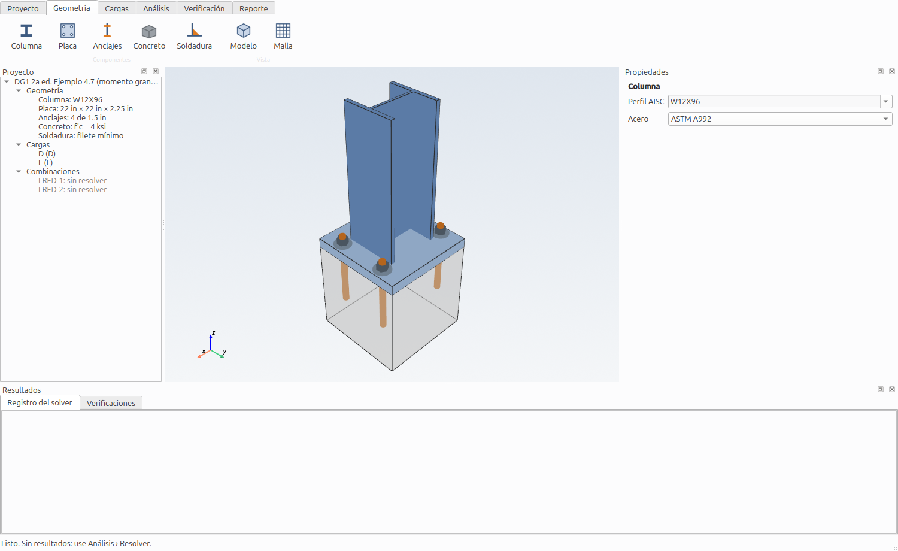
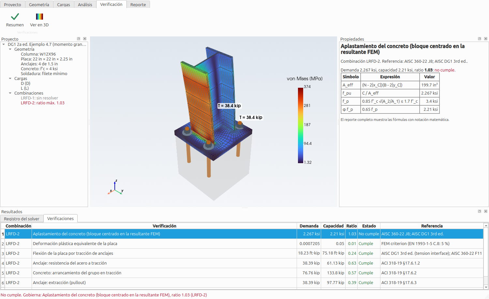
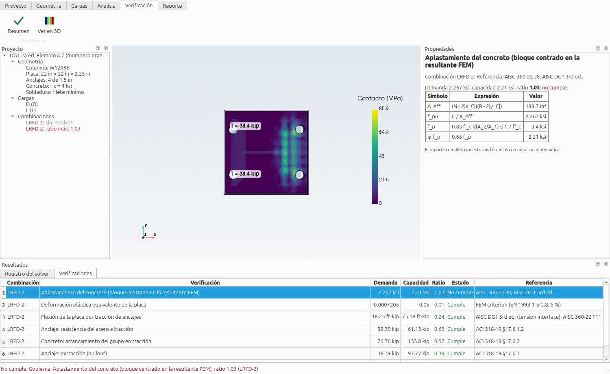

# Interfaz gráfica

```bash
./run-gui.sh examples/dg1_2ed_ej_4_7.ocnx
```

`run-gui.sh` lanza la interfaz desde este directorio. Qt necesita la librería
`libxcb-cursor0`; si no está instalada (`sudo apt install libxcb-cursor0`) el
script usa la copia local de OpenConex cuando existe.



## Flujo por etapas

El ribbon tiene una pestaña por etapa, en el orden de trabajo.

| Pestaña | Qué se hace |
|---|---|
| Proyecto | Nuevo, abrir y guardar (`.ocnx`, el mismo formato de OpenConex); unidades de presentación; normas (vigentes o las de la DG1 2.ª ed.) |
| Geometría | Columna (catálogo AISC con búsqueda), placa, anclajes, concreto y soldadura. El modelo 3D se actualiza al confirmar cada dato. Vista de modelo o de malla |
| Cargas | Tabla de casos (P, V, M en los dos ejes) y combinaciones ASCE 7 generadas, LRFD y ASD. Se marcan las que se van a resolver |
| Análisis | Ajustes de malla, resolver con CalculiX en segundo plano (con avance y botón de detener) y resultados en 3D: von Mises, deformación plástica, presión de contacto y desplazamiento, con la deformada amplificada y la tracción de cada anclaje |
| Verificación | Tabla de verificaciones con demanda, capacidad, ratio y referencia; al seleccionar una fila se ve su traza de cálculo |
| Reporte | Genera el reporte HTML (con la vista 3D actual), lo abre en el navegador o exporta un PDF resumido |

A la izquierda está el árbol del proyecto, que también sirve para navegar; a la
derecha, las propiedades de lo seleccionado; abajo, el registro del solver y
las verificaciones. La barra de estado dice si los datos son válidos, si los
resultados quedaron desactualizados por un cambio y qué verificación gobierna.





Los valores se escriben con su unidad (`22 in`, `560 mm`, `376 kip`); un número
solo se interpreta en las unidades del proyecto. Un dato inválido, por ejemplo
un anclaje cuya arandela se sale de la placa, se informa en la barra de estado
y desactiva Resolver.

Los resultados se guardan junto al proyecto, en `<nombre>_fem/`. Si el `.inp`
de una combinación no cambió, no se vuelve a correr CalculiX.

## Empaquetado

```bash
.venv/bin/pip install pyinstaller
```
```bash
.venv/bin/pyinstaller --noconfirm packaging/openfemconex.spec
```

Deja la aplicación en `dist/openfemconex/` (unos 1 GB por VTK y Qt), con Gmsh y,
si hay un `ccx` en el sistema al construir, también CalculiX. El mismo
ejecutable abre la interfaz o, con `run`, hace de línea de comandos. Al correr
prefiere el `ccx` del sistema y usa el incluido si no hay otro.

Estado por sistema:

| Sistema | Estado |
|---|---|
| Linux | Construido y probado en Ubuntu 24.04: interfaz y análisis con el `ccx` incluido. No se probó en una máquina sin CalculiX instalado, y el `ccx` de Ubuntu depende de OpenMPI, así que conviene verificarlo antes de distribuir |
| Windows y macOS | El flujo `.github/workflows/package.yml` los construye (CalculiX desde conda-forge y Homebrew), pero no se ha ejecutado: el repositorio aún no tiene remoto |

Pendiente para una distribución formal: AppImage en Linux, instalador en
Windows, firma y notarización en macOS.
