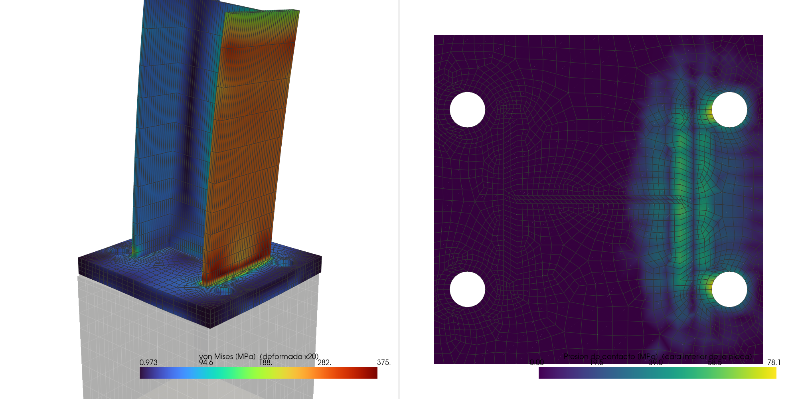

# Validación del modelo FEM

## Ejemplo 4.7 de la Guía de Diseño 1 del AISC (2.ª edición): momento grande

Datos del ejemplo: columna W12×96, Pu = 376 kips, Mu = 3600 kip·in (eje fuerte),
f'c = 4 ksi, placa de 22 × 22 × 2¼ in con Fy = 36 ksi, cuatro anclajes de 1½ in
ASTM F1554 Gr. 36 (dos por lado), 18 in de empotramiento. El proyecto está en
[`examples/dg1_2ed_ej_4_7.ocnx`](../examples/dg1_2ed_ej_4_7.ocnx) y la
combinación LRFD-2 (1.2D + 1.6L) reproduce las cargas del ejemplo.

```bash
.venv/bin/openfemconex run examples/dg1_2ed_ej_4_7.ocnx --combo LRFD-2
```

La guía calcula con los anclajes a 1.5 in del borde (f = 9.5 in) y después
adopta 2¼ in por el tamaño del agujero, sin recalcular. El modelo usa la
posición final (f = 8.75 in), porque con 1.5 in la arandela de placa de 3½ in
no cabe en la placa. Por eso la tabla trae las dos referencias analíticas.

| Resultado | DG1 publicado (f = 9.5 in) | DG1 con f = 8.75 in | FEM |
|---|---|---|---|
| Tracción total en anclajes | 76.0 kips | 82.2 kips | 76.7 kips |
| Tracción por anclaje | 38.0 kips | 41.1 kips | 38.4 kips |
| Compresión sobre el concreto | 452 kips | 458 kips | 452.7 kips |
| Longitud de apoyo Y | 9.30 in | 9.42 in | 9.9 in |
| Presión de apoyo | 2.21 ksi (uniforme) | 2.21 ksi | media 2.9 ksi, pico 12.6 ksi |

Valores FEM con la malla por defecto (14 mm). El equilibrio se cumple: la
compresión menos la tracción iguala a Pu (error 0.00 %) y el momento de las
reacciones iguala a Mu (error menor a 0.1 %).



### Por qué difieren

- **Tracción.** El FEM da 7 % menos que la fórmula de la guía con la misma
  posición de anclajes. La guía supone un bloque rectangular de presión
  uniforme de 2.21 ksi pegado al borde; en el modelo la compresión se concentra
  bajo el patín comprimido, con la resultante a 6.4 in del eje (la guía la pone
  a 6.3 in), y los anclajes ceden algo al alargarse.
- **Presión de apoyo.** La placa no es rígida: la presión no es uniforme sino
  que sigue la huella del patín, con picos locales altos. El concreto del
  modelo es elástico, así que el pico no se limita; es un indicador, no la
  demanda de diseño. La comparación con φ·0.85·f'c se hará en el paso 3 con
  un área efectiva, no con el pico.
- **Longitud de apoyo.** El valor FEM mide hasta dónde hay contacto (presión
  mayor al 1 % del pico), que es más que la longitud del bloque equivalente.

### Convergencia de malla

| Tamaño fino | Hexaedros | Tracción total | Longitud de apoyo | PEEQ máx. en placa | Tiempo de ccx |
|---|---|---|---|---|---|
| 20 mm | 4 434 | 76.3 kips | 10.3 in | 0.08 % | 50 s |
| 14 mm (por defecto) | 7 322 | 76.7 kips | 9.9 in | 0.36 % | 100 s |
| 9.3 mm | 13 960 | 77.5 kips | 9.6 in | 0.07 % | 220 s |

La tracción cambia 1.0 % entre los dos niveles más finos y la longitud de apoyo
3 %, dentro del 5 % que pide la especificación. La deformación plástica máxima
es un valor nodal extrapolado en la esquina del patín y no converge de forma
monótona: es sensible a la malla y habrá que promediarla en una zona antes de
usarla como criterio (paso 3).

### Otros casos probados

- Mismo ejemplo con Vu = 44 kips: la fricción transfiere 43.7 kips y el momento
  cierra con 0.04 % de error.
- HSS10×10×½ con momento en los dos ejes: converge, con tracción solo en el
  anclaje de la esquina levantada.

## Limitaciones conocidas

- Concreto elástico, sin aplastamiento ni fisuración; el mortero no se modela
  como capa aparte (solo cuenta en la longitud libre del anclaje).
- Anclajes como resortes: no hay palanca local del perno ni cono de concreto.
  Sin arandelas soldadas no toman cortante.
- Soldadura como unión continua de nodos; no se extraen todavía las fuerzas por
  unidad de longitud en el contorno.
- Sin radios de acuerdo en perfiles W ni esquinas redondeadas en HSS.
- El ccx de Ubuntu usa el solver SPOOLES; con PaStiX o PARDISO sería bastante
  más rápido.
